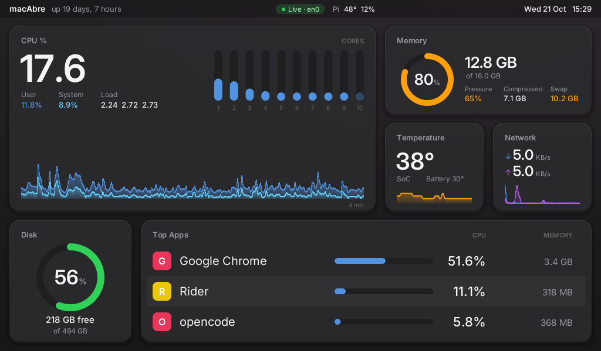

<div align="center">

# macdash

**Your Mac's vitals, live on a second screen.**

A tiny metrics agent for macOS and a dashboard for a Raspberry Pi, talking over
your LAN. Plug a small display into the Pi, and leave it running.

[](https://www.rust-lang.org)
[](#)
[-c51a4a.svg)](#)
[](LICENSE)

</div>

<p align="center">
  
  <br>
  <sub>The pixel dashboard as it appears on the Pi's 1024×600 panel, drawn straight into the framebuffer.</sub>
</p>

## What it is

- **`macdash-agent`** runs on the Mac. It reads the system stats and streams them over UDP, five times a second.
- **`macdash-tui`** runs on the Pi (or anywhere else) and draws them.

The two find each other automatically: no IP addresses, no pairing, no sudo.

**What you see:** CPU (total, per core, user/system, load) · memory (used,
pressure, compressed, swap) · SoC and battery temperature · network throughput ·
disk usage · your top apps, with helper processes counted together · the Mac's
clock · the Pi's own temperature and load.

**What it costs:** about 0.012% of one Mac core, 5 MB of RAM and 37 kbps of
network. The Pi binary is a single 700 KB static file.

### Two ways to draw it

| | Pixel dashboard (main) | Text dashboard (TUI) |
|---|---|---|
| Where | The Pi's own screen | SSH, a Mac terminal, or `--text` |
| How | Draws every pixel straight into the framebuffer (`/dev/fb0`): rounded cards, smooth charts, the Inter font | Terminal UI built with [ratatui](https://ratatui.rs) |
| Look | macOS-style, laid out for a 1024×600 panel | Denser, themeable |
| Top apps | 3, large | 8 |
| Themes | One fixed look | 8 (press `t`) |

The pixel dashboard is picked automatically when the program runs on the Pi's
console (`TERM=linux`) and `/dev/fb0` works. Otherwise, it falls back to text.

The text dashboard is a plain alternative for when you are not at the Pi's
screen. It has less room, so it trades pictures for more numbers.

---

## Run it

Both machines must be on the same LAN.

### Try it without installing

```bash
cargo run --release -p macdash-agent      # on the Mac
cargo run --release -p macdash-tui        # in another terminal, or any machine on the LAN
```

Press `q` to quit. In a normal terminal, this shows the text dashboard.

### Install on the Mac

```bash
./deploy/install-mac.sh
```

Builds the agent and installs it as a launchd agent: it starts at login and
keeps running.

### Install on the Pi

Building for the Pi needs Docker and the `cross` tool on the Mac:

```bash
cargo install cross --git https://github.com/cross-rs/cross
./deploy/build-pi.sh                       # add --zero2 for a Pi Zero 2 W
./deploy/install-pi.sh pi@192.168.0.148
```

The pixel dashboard now starts on the Pi's screen at boot, with no keyboard, and
finds the Mac by itself. Run the same two commands again to update.

A typical setup for a 7-inch HDMI panel:

```bash
./deploy/install-pi.sh pi@192.168.0.148 --hdmi
```

### Watch over SSH too

The agent streams to every display it finds, so the panel and a terminal can run
together:

```bash
ssh pi@192.168.0.148
macdash-tui --port 0      # port 0: the service already uses 9999
```

More screens work with no setup: install on another Pi.

---

## Options

### `install-pi.sh <user@host> [options]`

Options are saved in the service. Orientation and font are kept on later
installs unless you pass a new one; pass everything else again.

| Option | What it does |
|---|---|
| `--hdmi` | Turn the HDMI screen off while the Mac's display sleeps |
| `--backlight <path>` | Same, for panels with a Linux backlight, e.g. `/sys/class/backlight/rpi_backlight` |
| `--portrait` | Panel turned 90° clockwise, connectors at the bottom |
| `--landscape-flipped` | Panel upside down |
| `--landscape` | Back to normal orientation |
| `--font <name>` | Console font. Default `Lat15-Terminus16` (1024×600); `Lat15-Terminus32x16` for 1080p |
| `--ttf <file>` `--ttf-size <px>` `--ttf-cell <WxH>` | Use your own `.ttf`/`.otf` as the console font (needs `freetype-py`). `--ttf-cell 8x16` keeps the full 128×37 grid |
| `--mac <ip>` | Also announce directly to this Mac (the installer fills it in) |
| `--theme <name>` | Colour scheme of the text dashboard |
| `--text` | Use the text dashboard on the Pi's screen instead of the pixel one |
| `--zero2` | Install the Pi Zero 2 W build |

### `macdash-tui`

| Flag | |
|---|---|
| `--text` | Force the text dashboard, even on the Pi's console |
| `--theme <name>` | Text theme (see below) |
| `--hdmi` | HDMI off while the Mac's display sleeps (VC4/KMS, `fb0`) |
| `--backlight <path>` | Backlight to darken while the Mac sleeps |
| `--font <path>` | Console font to load before drawing |
| `--mac <ip>` | Also announce directly to this Mac |
| `--port <n>` | Listen port (default 9999; `0` picks any free port) |
| `--name <label>` | Name shown in the agent's logs |
| `--no-beacon` | Don't announce (use with the agent's `--target`) |

### `macdash-agent`

| Flag | |
|---|---|
| `--target <ip[:port]>` | Also stream to a fixed address (repeatable) |
| `--interval <ms>` | Sampling interval (default 200, minimum 50) |
| `--once` | Print one snapshot as JSON and exit |
| `--list-sensors` | Dump raw thermal sensors |
| `-v` | Log discovery and send counts |

### Text themes

Themes apply to the text dashboard only. Press **`t`** to cycle, then set a
favourite with `--theme`.

| Theme | Normal | Warning | Critical |
|---|---|---|---|
| `classic` (default) | blue | yellow | red |
| `traffic` | green | amber | red |
| `quiet` | plain white: colour only when something is wrong | amber | red |
| `thermal` | teal | warm amber | red-orange |
| `phosphor` | dark amber | bright amber | red-orange |
| `sapphire` | blue | amber | soft red |
| `grey` | light grey | white | red |
| `graphite` | green | orange | red, on a macOS dark-mode grey with rounded panels |

---

## Using it

**Status** (bottom left):

| Status | Meaning | Screen |
|---|---|---|
| `LIVE` | data is arriving | normal |
| `DISPLAY OFF` | the Mac's display is asleep | off with `--hdmi`/`--backlight`, values current |
| `STALE` | no data for 1–10 s | values dimmed |
| `ASLEEP` | no data for over 10 s | off, values dimmed |
| `WAITING` | no Mac found yet | see Troubleshooting |

**Keys:** `t` cycles themes (text only) · `q`, `Esc` or `Ctrl-C` quits.

**Reading the numbers:** the big CPU figure is the whole machine (0–100%). App
percentages count one core as 100%, so they can add up to more than the big
figure. Network rates are bytes per second (`K` = 1024).

## How it works

**Finding each other.** Every 3 s the display sends an "I'm here" message to the
multicast group `239.255.42.99:9998`. The agent listens and sends stats back to
wherever it came from. A Pi that reboots or changes address is found again in
seconds.

**Sending the numbers.** Five times a second the agent reads the stats straight
from macOS and sends them as one JSON snapshot in a single UDP packet (under
1400 bytes) to port 9999. No connection to keep alive: a lost packet is replaced
by the next one 200 ms later.

**Drawing.** On the Pi there is no desktop, browser or GPU toolkit. The display
draws the whole image itself and writes it into the framebuffer, redrawing only
the parts that changed, which keeps a Pi Zero fast. Over SSH or in a Mac
terminal, the same data goes through the text renderer.

**Network:** 9998/udp (discovery, multicast) and 9999/udp (stats, unicast). Both
stay on the local network.

## Troubleshooting

**The screen stays on `WAITING`.** Check the agent runs
(`launchctl list | grep macdash`). If it does, your router probably blocks
multicast: reinstall with `--mac <your Mac's IP>`, or start the agent with
`--target <pi-ip>`.

**The screen is blank, with no dashboard and no login prompt.** An install failed
partway. Give the console back and try again:

```bash
./deploy/fix-pi-console.sh pi@192.168.0.148
```

**Bars show as `#` or panels are missing (text dashboard).** The console font
failed to load or is too big. Reinstall without `--font`, or with
`--font Lat15-Terminus16`.

**Restart or inspect the Pi service:**

```bash
sudo systemctl restart macdash
systemctl status macdash macdash.timer
journalctl -u macdash -b
```

**Temperature is missing.** It uses a private macOS API that a future macOS might
break; everything else keeps working. `macdash-agent --list-sensors` shows the
raw data.

**Check without a screen:** `macdash-agent --once` prints one snapshot as JSON,
and `cargo run -p macdash-tui --example snapshot` renders one text frame.

## Development

```bash
cargo test --workspace
cargo run --release -p macdash-agent --example bench     # where the agent's time goes
```

Three crates: `proto` (wire format), `agent` (macOS) and `tui` (the display, both
renderers). [ANALYSIS.md](ANALYSIS.md) covers the design: why UDP and beacons,
how the CPU cost went from 22% to 0.012%, and sleep detection.

## Credits

The pixel dashboard uses [Inter](https://rsms.me/inter/) by Rasmus Andersson,
under the SIL Open Font License (`crates/tui/assets/fonts/LICENSE-Inter.txt`),
embedded in the binary.

## License

MIT
